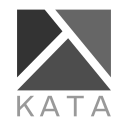

# Kata



*A language of forms for thought.*

Kata helps people and agents arrange supplied content for clear visual
communication. Its current responsibility is layout: placement, available
space, grouping, and reading order. It does not author or rewrite content,
derive its internal relationships, or redesign the inside of a supplied chart,
table, infographic, or other item. A suitable result can be keeping the
existing layout when it already works.

Kata's longer-term vision spans post-its, slides, diagrams, and other visual
layers. The current release applies layout guidance to supplied content in a
small repertoire of slide forms. See [VISION.md](VISION.md) for the broader
direction and its distinction from today's scope.

**Kata 0.3.0: six forms, a six-slide field guide, seven retained before-and-after pairs, and an offline 14-slide Lys deck.**

The sixth pattern, golden cut, gives a supplied item more space when the brief
supports that emphasis. The [Kata skill](skills/kata/SKILL.md) explains when an
existing arrangement should stay and how to use the catalogue within the
current scope.

## Try it

Open [the visual gallery](examples/index.html) in a browser to compare the examples.
Open [the Lys deck](examples/kata-lys.html) to present them. Use the arrow keys to
move through all 14 slides, or the top navigation to jump to an after example.
Both files work locally without a server or network connection. The deck is a
single file and can be copied on its own.

To use the guidance with an agent, ask:

> Read `skills/kata/SKILL.md` and review this slide's layout using Kata.
> Preserve the supplied content and tell me whether a layout change is needed.

The [field guide](examples/field-guide.html) presents the six current forms,
with a specimen and fit explanation on each slide.

For persistent skill discovery, copy the entire `skills/kata` folder into your
agent's skills directory, such as `~/.codex/skills/kata`. The skill is self-contained;
its installation does not require the gallery, Node, Lys, or a brand skill. This
repository does not install anything automatically.

## Patterns

| Form | Pattern | Audience question |
| --- | --- | --- |
| [Comparison](skills/kata/references/comparison.md) | Aligned matrix | How do these options differ on common criteria? |
| [Composition](skills/kata/references/composition.md) | Whole and parts | Where does the total go? |
| [Hierarchy](skills/kata/references/hierarchy.md) | Nested groups | What belongs where? |
| [Relationship](skills/kata/references/relationship.md) | Directed dependencies | What must happen before what? |
| [Change over time](skills/kata/references/change-over-time.md) | Time series | What changed, by how much, and when? |
| [Golden cut](skills/kata/references/golden-cut.md) | Asymmetric composition | What is primary, with context beside it? |

Each pattern includes its affordances, constraints, a worked specimen, and a
review check. All example data is fictional. Some retained specimens show
information restructuring or headline writing beyond Kata's current scope;
they document the existing catalogue and are not instructions to perform that
work. For current layout guidance, begin with the supplied-content boundary in
the [Kata skill](skills/kata/SKILL.md) and its [shared layout assessment](skills/kata/references/layout-assessment.md).

The patterns describe when a form can help and when it gets in the way. Their
rationales distinguish design judgment and Gestalt analogies from empirical
evidence; they do not claim that these layouts or Kata have been empirically
validated. Specific claims about perception or psychology should be supported
by relevant research and presented with its limits. General deck storytelling
is outside this release's scope. The golden cut uses 61.8/38.2 only as an
optional spatial proportion; it does not encode quantities or establish
preference or comprehension.

## Kata, Lys, and brand skills

Kata arranges supplied content through placement, available space, grouping,
and reading order. Lys supplies output behavior. An optional brand skill
supplies visual identity. See [integration notes](skills/kata/references/integration.md).

Slides are Kata's current medium; Lys can render them in different formats,
including vertical phone screens. The projects may inform each other as they
develop. This is a direction, not a claim that a packaged integration exists.

The example deck embeds the locally available Lys 1.2.1 runtime. Runtime provenance
is recorded in [the vendor notice](examples/vendor/NOTICE.md). The cream and rust
example theme is neutral; Futurice branding has not been supplied or tested.
There is no separate `kata-lys` package in this release.

## Kata and ASDLC.io

[ASDLC.io](https://asdlc.io) is our pattern library for harness engineering:
it documents concepts, patterns, and practices for engineering with agents.
We use its guidance to develop Kata's agent instructions and internal workflows.
Kata's delivered skill supplies focused guidance for arranging supplied
content.

Development guidance lives in [AGENTS.md](AGENTS.md); `CLAUDE.md` links to the
same file. Internal development skills live under `.agents/skills/` with
`kata-dev-` names. When authoring Lys decks, repository agents use the
[version-pinned Lys skill](.agents/skills/lys/SKILL.md), which is development
guidance and is not part of the portable delivered skill in `skills/kata/`.

## Work on the examples

Node 20 or newer is enough. There are no npm dependencies to install.

```sh
npm run build
npm run check
```

Edit [example data](examples/data.json), [the generator](scripts/build-examples.mjs),
or [the theme](examples/theme.css), then rebuild. Commit the generated HTML alongside
the sources so the examples stay usable immediately after checkout. The build runs
no network requests and makes no changes to the neighboring Lys project.

`npm run check` checks harness instructions, source data, portable and
development skill references, the field guide's form coverage and content
integrity, slide structure, unique IDs, navigation targets, and offline
packaging. It also checks versioned evaluation cases and runner protocol paths
without invoking model CLIs. These structural checks do not replace visual
review. When changing a rendered layout, inspect the affected gallery, field
guide, or deck at presentation and phone sizes, with keyboard navigation,
no-JavaScript reading, and print where supported; record any gaps.

## Evaluation

The [0.3.0 artifact review](docs/evals/0.3.0-review/README.md) records field-guide
coverage, source checks, visual review, dogfooding corrections, and remaining
verification limits. See also the [release notes](docs/releases/0.3.0.md).

The versioned cases, shared run contract, CLI adapters, and Lys artifact checks
are under [evals](evals/runner/README.md). The [0.2.0 evaluation report](docs/evals/report.md)
records outcomes separately for Claude Code, Codex CLI, and pi. The report
distinguishes agent review and automated artifact checks from human reader
feedback; it does not claim improved comprehension from generated slides.

## Roadmap

See the [Kata roadmap](docs/plans/ROADMAP.md) for planned work and open questions.

The [original brief](docs/initial-brief.md) records the starting intent from
2 October 2026.
